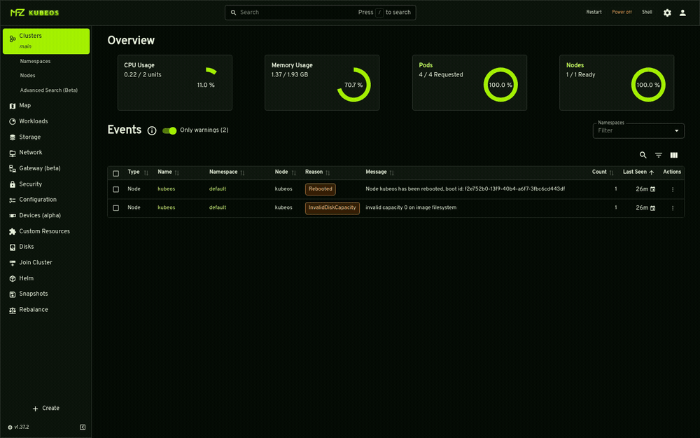
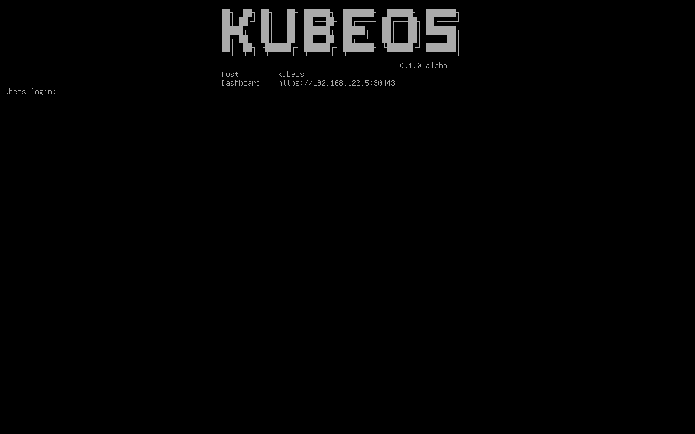

# KubeOS

KubeOS is a Debian-based Linux distribution that turns a machine into a single-node
Kubernetes platform with a browser-based dashboard. The image carries the container
runtime, the cluster, pod networking, storage, DNS, metrics and the dashboard, so an
installed machine is a working cluster. Further machines installed with the same image
join it as worker nodes from the dashboard.

KubeOS is built for operators running container workloads on their own hardware.

**Current release:** 0.1.0 alpha (Orhan)

## Login prompt

## Project

- Website — <https://kubeos.in>
- Documentation — <https://kubeos.in/docs.html>

## Bug reports and feedback

Bug reports and feedback are welcome — open an issue in this repository. For a bug, include
the KubeOS version (`grep PRETTY_NAME /etc/os-release`), the steps that led to it and the
relevant lines from `journalctl -b`. Feedback on the installer, the dashboard, or anything
unclear in this repository, is equally useful.

## Licence

KubeOS is distributed under the Apache License 2.0 — see `LICENSE`. Third-party
components, their licences and where to obtain their source are listed in
`docs/LICENSES.md`; notices shipped with the image are in `NOTICE`.

KubeOS is not affiliated with, endorsed by or sponsored by the Kubernetes project, the
Cloud Native Computing Foundation, the Debian project or the Headlamp maintainers.
